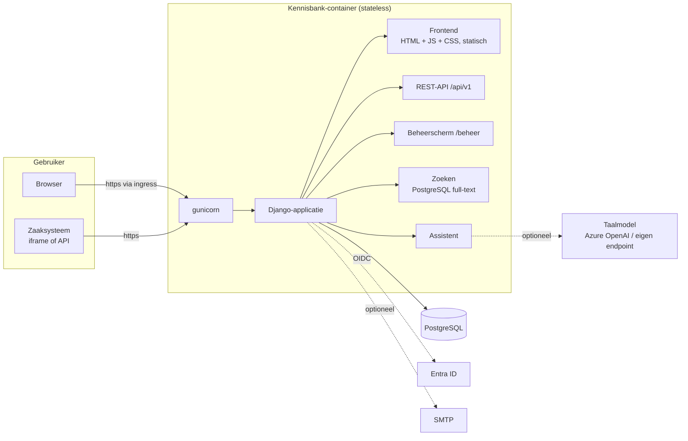
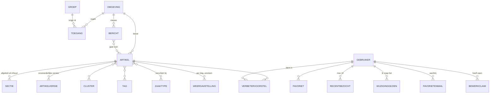

# Architectuur

## Componenten

| Laag | Keuze | Waarom |
|---|---|---|
| Taal en framework | Python 3.12+, Django 5.2 LTS | Breed bekend, LTS met beveiligingsupdates tot april 2028, ingebouwd beheerscherm, rechten en migraties |
| API | Django REST Framework, OpenAPI 3 via drf-spectacular | Gestandaardiseerd, schema in [openapi.yaml](openapi.yaml) en op `/api/docs/` |
| Database | PostgreSQL | Ook de zoekmachine (Nederlandse woordstammen); geen aparte zoekdienst nodig. Een beheerde PostgreSQL werkt zonder aanpassing; wat een ánder databaseproduct zou kosten, staat in [installatie en beheer](installatie-en-beheer.md#een-andere-database-dan-postgresql) |
| Frontend | Eén HTML-pagina, vanilla JavaScript en CSS, zonder build-stap | Niets te compileren, geen npm-afhankelijkheden in productie, strenge CSP mogelijk |
| Editor voor artikelen | Tiptap 3 met ProseMirror (MIT), gebundeld in `vendor/tiptap/` (bron: `frontend/`) | Secties en onboarding als vaste bouwblokken in het schema (een sectie kan niet half kapot of genest), bewerken zoals de lezer het ziet, opmerkingen als decoratie; geen externe verbindingen |
| Editor voor nieuwsberichten | Jodit 4 (MIT), lokaal meegeleverd | Word-achtige opmaak; artikelen gebruiken sinds 1.22.0 Tiptap |
| Word-import | mammoth (BSD) | Zet .docx om naar schone HTML (alleen tekst en opmaak; secties en onboarding maak je in de editor) |
| Webserver | gunicorn + WhiteNoise | Statische bestanden komen uit de container zelf; geen aparte webserver |
| Inloggen | OpenID Connect (mozilla-django-oidc) | Sluit aan op Entra ID; groepen bepalen de rollen |

## Datamodel

- **Omgeving**: afgeschermd deel van de kennisbank (bijv. per afdeling). Hiermee kan de applicatie later ook buiten één afdeling worden gebruikt zonder dat artikelen door elkaar lopen.
- **Toegang**: groep uit de identity provider + rol (*lezer* of *redacteur*) per omgeving. Functioneel beheerders (`KB_BEHEERDERS_GROEPEN`) mogen alles.
- **Artikel**: één HTML-tekst (`inhoud`) uit de editor of uit een Word-import, bij opslaan én bij tonen opgeschoond met een allowlist (`inhoud.py`). Daarin zijn `<section class="sectie">` kaders met een `<h2 class="sectie-kop">` titel de in- en uitklapbare secties (tekst buiten een kader is altijd zichtbaar; kaders nesten niet), en `
` blokken uitleg voor nieuwe collega's, die de frontend alleen met de onboarding-schakelaar toont. `inhoud.blokken()` levert de tekst in leesvolgorde op als tekst- en sectieblokken.
- **Sectie** (sinds 1.8.1 géén rij meer voor lege vrije tekst: zo'n rij droeg de artikeltitel in zijn zoekdocument en won daarmee zoekopdrachten zonder iets te kunnen tonen; migratie 0011 ruimt bestaande op) is een *afgeleide* tabel: bij elke opslag opnieuw opgebouwd uit `inhoud` (`diensten.herbouw_secties`), zodat zoeken en de assistent per sectie kunnen werken. Volgorde 0 is alle vrije tekst samen.
- **Zoekdocumenten** (`Artikel.zoekvector`, `Sectie.zoekvector`, type `tsvector` met GIN-index) worden in dezelfde stap bijgewerkt. Zoeken is daardoor een indexopzoeking die meeschaalt met het aantal artikelen; titel en tags wegen het zwaarst, dan de samenvatting, dan de tekst.
- **Links** werken op het nummer van het artikel: `/artikel/412/melding-registreren`. De naam (`slug`) is alleen leesbaar. Hij is uniek *binnen een omgeving* — twee artikelen met dezelfde titel in dezelfde omgeving krijgen `-2`, `-3` enzovoort — maar bewust niet daarbuiten: twee omgevingen mogen dezelfde titel en dezelfde slug hebben, want anders zou een redacteur uit die `-2` kunnen afleiden dat er elders een artikel met dezelfde titel bestaat. Links van vóór versie 1.2 (`/artikel/<slug>`) worden doorverwezen; komen er meerdere artikelen in aanmerking, dan gaat de verwijzing naar het meest recent gewijzigde dat de bezoeker mag lezen.
- **Artikelversie**: elke wijziging van een gepubliceerd artikel levert een onveranderlijke momentopname op, met wie, wanneer en waarom. Zo is altijd te reconstrueren welke instructie op welk moment gold. De vlag `kleine_correctie` (typfout, opmaak) zorgt dat zo'n versie geen melding of e-mail oplevert; versie 1 (de publicatie zelf) telt ook niet als wijziging.
- **WijzigingGezien**: per gebruiker en artikel het versienummer tot waar de wijzigingsmelding is afgevinkt. `diensten.wijzigingen_voor()` bepaalt per artikel de openstaande melding: de hoogste inhoudelijke versie > 1, gepubliceerd ná de eerste inlog van de gebruiker (`date_joined`) en hoger dan het afgevinkte nummer.
- **FavorietenMail**: wachtrij voor de e-mail aan wie het artikel als favoriet heeft; `diensten.verstuur_favorietenmail()` bundelt per ontvanger (zie `KB_FAVORIETEN_MAIL`).
- **BewerkClaim**: wie heeft dit artikel nu in het bewerkscherm open. Een zacht slot: het bewerkscherm verlengt de claim elke 30 seconden en hij vervalt na twee minuten (`diensten.CLAIM_VERVALT_NA`), zodat een gesloten tabblad nooit een artikel op slot laat staan. Een tweede redacteur krijgt een waarschuwing en mag doorgaan; beiden zien van elkaar dat ze in hetzelfde artikel zitten. Hetzelfde verzoek is meteen de controle op de beveiligingscode: komt er een 403 terug, dan meldt het scherm dat de sessie is verlopen vóórdat er wordt opgeslagen. Daarnaast weigert het beheerformulier een opslag waarvan het scherm ouder is dan de laatste wijziging (verborgen veld `geladen_stempel` tegen `Artikel.gewijzigd_op`), zodat niemand stilletjes het werk van een ander overschrijft. Die controle leest het artikel sinds 1.8.0 met `select_for_update()`, binnen dezelfde transactie als het schrijven: zonder vergrendeling kwamen twee gelijktijdige opslagen er allebei doorheen. Een ontbrekend stempel geldt als conflict (falen naar de veilige kant), en elk pad dat de status wijzigt werkt `gewijzigd_op` bij — een bulk-`update()` doet dat niet en maakte de controle blind.
- **Kladversie**: onopgeslagen werk in het bewerkscherm, één per redacteur per artikel (voor een nieuw artikel: `artikel` leeg, één per redacteur). Twee lagen: de browser bewaart elke paar seconden een kopie in `localStorage` (werkt offline), de server krijgt de kladversie elke twee minuten, bij `online` en bij `pagehide` (`sendBeacon`). Bij openen vergelijkt `beheer-editor.js` de browser- en de serverkopie en vraagt of de redacteur verder wil. Terugzetten zet ook `geladen_stempel` terug naar het stempel van toen, zodat de conflictcontrole hierboven aanslaat als iemand anders intussen heeft opgeslagen. Na opslaan of weggooien blijft een lege rij met `afgesloten_op` staan: zonder die grafsteen zou een oude browserkopie op een andere laptop de kladversie later laten herrijzen. Pas een kladversie als de redacteur echt iets heeft gedaan (typen, plakken, werkbalk): de editor maakt HTML na het laden soms net anders op, en alleen openen mag geen kladversie geven. `opschonen` ruimt alles ouder dan `KB_KLADVERSIE_DAGEN` op.
- **Bericht**: nieuwsbericht per omgeving, met dezelfde opschoning als artikelinhoud, optioneel gekoppeld aan artikelen, vastgepind en/of met een vervaldatum. Niet in de export/import; nieuws is tijdgebonden.
- **Tellingen** (weergaven, zoektermen, assistentgebruik) zijn per dag en per omgeving geaggregeerd en bevatten geen gebruikers.

## Rechten

| | Lezer | Redacteur (procesmanagement) | Functioneel beheerder |
|---|---|---|---|
| Gepubliceerde artikelen lezen, zoeken, assistent | ✓ | ✓ | ✓ |
| Favorieten, onboarding, verbetervoorstel indienen | ✓ | ✓ | ✓ |
| Eigen voorstellen en terugkoppeling zien | ✓ | ✓ | ✓ |
| Open voorstellen van collega's zien (zonder naam) en steunen | ✓ | ✓ | ✓ |
| Concepten zien, artikelen schrijven en publiceren | | ✓ eigen omgeving | ✓ |
| Voorstellen behandelen (bakken), statistieken | | ✓ eigen omgeving | ✓ |
| Omgevingen, toegang, verwijderen | | | ✓ |

Alle controles zitten op één plek ([kennisbank/rechten.py](../kennisbank/rechten.py)) en gelden zowel voor de API als het beheerscherm. Een artikel waar iemand geen toegang toe heeft geeft 404, niet 403, zodat het bestaan ervan niet uitlekt.

## Belangrijke stromen

**Artikel lezen.** De frontend haalt `GET /api/v1/artikelen/<id>` op en meldt `POST …/weergave`. Dat verhoogt de anonieme dagtelling en zet het artikel bovenaan in "recent bezocht" van de gebruiker.

**Publiceren.** Een redacteur bewerkt in `/beheer/`. Bij opslaan met status *gepubliceerd* vergelijkt de applicatie de inhoud met de laatste versie. Bij verschil ontstaat versie *n+1* met de opgegeven toelichting (verplicht, tenzij *kleine correctie*). Ongewijzigd opslaan maakt geen versie. Een inhoudelijke versie > 1 zet de wijzigingsmelding klaar voor alle lezers (berekend bij het ophalen, niets wordt vooraf per gebruiker opgeslagen) en een regel in de mailwachtrij voor elke favoriet-houder met e-mail die de mail niet heeft uitgezet. Optioneel ontstaat een concept-nieuwsbericht.

**Verbetervoorstel.** Een medewerker selecteert tekst, en het voorstel wordt opgeslagen met het citaat en het versienummer van het artikel op dat moment. Liggen er bij dat artikel al open voorstellen, dan toont de frontend die eerst (`GET /api/v1/voorstellen?lijst=alle&artikel=<id>`), zodat hij het bestaande voorstel kan steunen (`PUT …/voorstellen/<id>/steun`). Een nieuw voorstel komt in de **gezamenlijke bak** van de omgeving (`eigenaar` leeg); redacteuren van die omgeving krijgen (als e-mail is ingesteld) één samenvatting per dag (`diensten.verstuur_voorstellenmail`, vanuit `opschonen`). Op de werkplek in het beheer pakken redacteuren het op, wijzen het toe of leggen het terug; dat loopt via `diensten.voorstel_naar_bak`, die de status, het slot en de e-mail aan een collega regelt. Bij een statuswijziging zet `diensten.eigenaar_bij_statuswijziging` de eigenaar (wie afhandelt, is eigenaar), en `diensten.bakken_rechtzetten` legt voorstellen terug als de eigenaar geen redacteur van de omgeving meer is (bij een rechtenwijziging, het verhuizen van een artikel, en dagelijks in `opschonen`). Het behandelscherm (`kennisbank/behandelen.py`, `/beheer/voorstel/<id>/`) vergelijkt bij versturen wat er bij het openen stond (status, eigenaar, laatste bericht) met de database, zodat een verouderd scherm het werk van een collega niet terugdraait of een tegenstrijdig bericht verstuurt. Afhandelen loopt via `diensten.voorstel_afhandelen` (afsluitend bericht verplicht, definitief, eventueel `dubbel_van`); archiveren van een artikel sluit open voorstellen af als *Vervallen* (`diensten.voorstellen_vervallen`, via het signaal op `Artikel`). Interne notities (`VoorstelNotitie`) zijn alleen voor de redactie. Status en terugkoppeling zijn zichtbaar voor de indiener.

**Conceptversie.** Model `Conceptversie` (één per artikel, `velden` = het bewerkformulier als JSON). In het bewerkscherm zet `ArtikelAdmin.get_form` `als_concept` als op *Opslaan als conceptversie* (`_conceptversie`) is gedrukt; dan schrijft `save_model` alleen de conceptversie (`diensten.concept_opslaan`, onder slot, met de stempel `geladen_concept` tegen het overschrijven van een collega) en slaat `save_related` alles over (geen m2m, zoekindex, versie of melding). Is er een conceptversie, dan vult het formulier zich daarmee. Gewoon opslaan publiceert zoals altijd en verwijdert daarna de conceptversie; `_controleer_concept` weigert dat vanuit een scherm waarvan de conceptversie intussen veranderde. Medewerkers en de API lezen altijd het artikel zelf.

**Clusterbakken.** `Verbetervoorstel.cluster`: bij binnenkomst gezet door `Verbetervoorstel.save()` (`standaard_clusterbak`: precies één cluster bij het artikel → dat cluster, anders leeg = Algemeen), daarna te verplaatsen (`diensten.voorstel_naar_clusterbak`). Clusters zijn organisatiebreed; de werkplek toont alleen clusters die in de eigen omgevingen voorkomen (`werkoverzicht.clusters_van`).

**Werkplek in het beheer.** `/beheer/` is de werkplek uit `kennisbank/werkoverzicht.py`: links de bakken (werkvoorraad, alle procesmanagers, afgehandeld) en de artikelkant (concepten, kladversies, opnieuw nakijken), rechts de inhoud, met acties via `POST /beheer/werkplek/actie/`. Django's lijst met onderdelen staat onder "Alle onderdelen"; de oude voorstellenlijst staat daar niet meer in. Het aantal databasevragen is vast, ongeacht het aantal voorstellen of artikelen.

**Foutpagina's.** 400, 403, 404 en 500 hebben eigen Nederlandse pagina's (`kennisbank/views.py`, `templates/kennisbank/fout.html`) met een weg terug; onder `/api/` blijft het antwoord JSON. Met `DEBUG` aan toont Django zijn eigen foutinformatie.

**Assistent.** Zie [ai-assistent](ai-assistent.md).

**Zaaksysteem.** Zie [koppeling-zaaksysteem](koppeling-zaaksysteem.md).

## Broncode

| Pad | Inhoud |
|---|---|
| `config/` | Instellingen (alles via omgevingsvariabelen), URL's |
| `kennisbank/models.py` | Datamodel |
| `kennisbank/rechten.py` | Autorisatie |
| `kennisbank/api.py` | REST-API |
| `kennisbank/zoeken.py` | Zoeken |
| `kennisbank/assistent.py` | Assistent en koppeling met het taalmodel |
| `kennisbank/inhoud.py` | Opschonen van artikelinhoud (allowlist), onboarding-blokken |
| `kennisbank/word_import.py` | Word-document → artikel met secties |
| `kennisbank/diensten.py` | Publiceren/versies, tellingen, meldingen |
| `kennisbank/admin.py` | Beheerscherm |
| `kennisbank/auth.py` | OIDC-login en groepen |
| `kennisbank/static/kennisbank/` | Frontend |
| `kennisbank/management/commands/` | Beheercommando's (import, export, toegang, opschonen, demo) |
| `kennisbank/tests/` | Geautomatiseerde tests |

**Reviewproces (stap C, 1.19.0).** `kennisbank/review.py` bevat alle regels. Een `Reviewteam` (omgeving, Django-groep = Entra ID-groep, clusters) leest mee; een `Inzage` is één conceptversie bij één team in één ronde (status ter inzage, teruggegeven, akkoord, teruggeroepen; `afgesloten` na publiceren of weggooien). Zolang er een inzage *ter inzage* is, weigert `diensten.concept_opslaan` (`ConceptOpSlot`), weigert `ArtikelForm._niet_tijdens_review` publiceren en weigert `diensten.concept_weggooien` (`ConceptTerInzage`) weggooien (sinds 1.21.0; daarvoor publiceerde het formulier de opgeslagen conceptversie). Akkoord bewaart de stempel van de conceptversie (`akkoord_stempel`); wijkt die later af, dan is het akkoord vervallen. `review.samenvatting_bij_publiceren` schrijft de stand in `ArtikelVersie.review`. De leesweergave voor reviewers staat buiten het beheer (`kennisbank/reviewweergave.py`, `/review/`), met een verschil per blok en per woord (`kennisbank/verschil.py`, ge-escaped).

**Stap C2 en D (1.20.0).** Een verbetervoorstel kan worden meegenomen in de nieuwe versie (`Verbetervoorstel.in_conceptversie`); bij publiceren krijgt het `verwerkt_in_versie` en stuurt `ArtikelAdmin.response_change` naar `voorstellen-afhandelen/` (voorgevuld bericht per voorstel, afhandelen via `diensten.voorstel_afhandelen`). Spoedcorrectie: `?spoed=1` op het bewerkscherm; `get_form` zet `spoed`, het formulier opent de gepubliceerde tekst, `clean` slaat de conceptcontrole en het slot over, `save_related` laat conceptversie, review, kladversie en meegenomen voorstellen ongemoeid. Opmerkingen bij tekst: `ReviewOpmerking.citaat`; `static/kennisbank/opmerkingen.js` zoekt het citaat in de getoonde tekst (tekstknopen, zonder `<del>`) en zet genummerde `<mark>`-elementen, alleen via DOM-methodes. Gebruikt door `review.js` (selectie in de verschilweergave). Sinds 1.22.0 toont het bewerkscherm de opmerkingen zelf in de marge (`artikel-editor.js`); `voorbeeld.js` blijft voor *Bekijk als medewerker*. De redacteur ziet opmerkingen van de laatste ronde, pas als het team heeft gereageerd.

**Het bewerkscherm (1.22.0).** `templates/admin/kennisbank/artikel/change_form.html` levert in `form_top` een balk, een leeg blad (`data-kb-plek="titel|samenvatting|inhoud"`), een marge en lege panelen (`kb-p-eig`, `kb-p-gesch`, `kb-p-rev`); `artikel-scherm.js` verhuist de velden van het gewone beheerformulier daarheen, binnen het `<form>`, zodat opslaan, validatie en kladversie niet veranderen. `artikel-editor.js` maakt de editor op de textarea `inhoud` (`KBArtikelEditor.maak`), met een eigen schema: `doc` = `(block | sectieblok)+`, `sectie` = `sectieKop block+` (alleen op het hoogste niveau), `onboarding` = `block+`. Het opgeslagen HTML-formaat is hetzelfde als met Jodit; `voorbewerk` zet binnenkomende HTML in die vorm (kop in elke sectie, geen geneste secties), `naarOpslag` haalt de extra `
` in lijstpunten en tabelcellen en de lege slotregel weg. De server schoont daarna op zoals altijd (`inhoud.schoon`). Opmerkingen van de review zijn een ProseMirror-decoratie (plugin `kbOpmerkingen`) met kaarten in de marge op de hoogte van `coordsAtPos`. Het object dat `maak` teruggeeft, heeft dezelfde vorm als de oude Jodit-editor voor `beheer-editor.js` (`value`, `synchronizeValues`, `setReadOnly`), dus kladversie, slot en Afronden zijn ongewijzigd. *Bekijk als medewerker* toont `voorbeeld/` in een laag (zelfde `postMessage` als het oude splitscreen). De balk toont `review.balk_stand`.

**Afronden en de reviewbevindingen (1.21.0).** Onder een gepubliceerd artikel tekent `beheer-editor.js` (`afronden()`) één knop *Afronden…* met een keuzevenster; de gegevens komen uit `json_script` `kb-afronden` (`ArtikelAdmin.change_view`: spoed, op slot, teams, werkplek, akkoord). Het venster drukt op de bestaande, verborgen knoppen (`_conceptversie`, `_save`, `_terugroepen`), zodat toelichting, collega-bevestiging en kladversie ongewijzigd blijven werken. *Ter inzage aanbieden* verstuurt `_conceptversie` met `kb_daarna_ter_inzage=1` en `reviewteams`; `response_change` geeft na het opslaan ter inzage (`_ter_inzage_na_opslaan`). *Afbreken* gooit via `kbKladAfbreken` de kladversie weg (POST `weggooien=1`) en gaat naar de werkplek. `concept_opslaan` laat de stempel staan als er niets veranderde, zodat een akkoord blijft gelden; `diensten.wijkt_af_van_concept` bepaalt bij publiceren of de tekst afwijkt van de opgeslagen conceptversie ("Gepubliceerd met wijzigingen na het akkoord"). `review.stoppen` (archiveren, andere omgeving; via `signalen.artikel_opgeslagen`) sluit inzages af en mailt reviewers die bezig waren; `review.reviewproces_uitgezet` (signaal op `Omgeving`) roept alles terug. `review._inzage_voor` en de lijst eisen dat het team bij de huidige omgeving van het artikel hoort. Werkplekacties en *Oppakken* bij reviewers sturen de geladen eigenaar mee (`geladen_eigenaar`, `geladen_reviewer`) en doen niets als die intussen veranderde; *Verbergen* en *Meenemen* sturen de gewenste stand mee (`waarde`).
