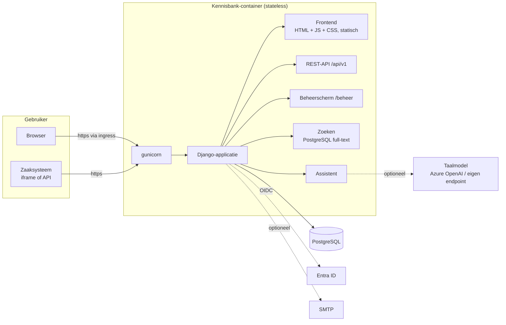
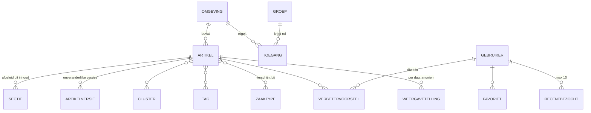

# Architectuur

## Componenten

| Laag | Keuze | Waarom |
|---|---|---|
| Taal en framework | Python 3.12+, Django 5.2 LTS | Breed bekend, LTS met beveiligingsupdates tot april 2028, ingebouwd beheerscherm, rechten en migraties |
| API | Django REST Framework, OpenAPI 3 via drf-spectacular | Gestandaardiseerd, schema in [openapi.yaml](openapi.yaml) en op `/api/docs/` |
| Database | PostgreSQL | Ook de zoekmachine (Nederlandse woordstammen); geen aparte zoekdienst nodig |
| Frontend | Eén HTML-pagina, vanilla JavaScript en CSS, zonder build-stap | Niets te compileren, geen npm-afhankelijkheden in productie, strenge CSP mogelijk |
| Editor in het beheer | Jodit 4 (MIT), lokaal meegeleverd | Word-achtige opmaak, tabellen, opschonen bij plakken uit Word; geen externe verbindingen |
| Word-import | mammoth (BSD) | Zet .docx om naar schone HTML; koppen worden secties, de stijl 'Onboarding' wordt een onboarding-blok |
| Webserver | gunicorn + WhiteNoise | Statische bestanden komen uit de container zelf; geen aparte webserver |
| Inloggen | OpenID Connect (mozilla-django-oidc) | Sluit aan op Entra ID; groepen bepalen de rollen |

## Datamodel

- **Omgeving**: afgeschermd deel van de kennisbank (bijv. per afdeling). Hiermee kan de applicatie later ook buiten één afdeling worden gebruikt zonder dat artikelen door elkaar lopen.
- **Toegang**: groep uit de identity provider + rol (*lezer* of *redacteur*) per omgeving. Functioneel beheerders (`KB_BEHEERDERS_GROEPEN`) mogen alles.
- **Artikel**: één HTML-tekst (`inhoud`) uit de editor of uit een Word-import, bij opslaan én bij tonen opgeschoond met een allowlist (`inhoud.py`). Daarin zijn `<section class="sectie">` kaders met een `<h2 class="sectie-kop">` titel de in- en uitklapbare secties (tekst buiten een kader is altijd zichtbaar; kaders nesten niet), en `
` blokken uitleg voor nieuwe collega's, die de frontend alleen met de onboarding-schakelaar toont. `inhoud.blokken()` levert de tekst in leesvolgorde op als tekst- en sectieblokken.
- **Sectie** is een *afgeleide* tabel: bij elke opslag opnieuw opgebouwd uit `inhoud` (`diensten.herbouw_secties`), zodat zoeken en de assistent per sectie kunnen werken. Volgorde 0 is alle vrije tekst samen.
- **Links** werken op het nummer van het artikel: `/artikel/412/melding-registreren`. De naam (`slug`) is alleen leesbaar en hoeft niet uniek te zijn; twee omgevingen kunnen dezelfde titel gebruiken. Links van vóór versie 1.2 (`/artikel/<slug>`) worden doorverwezen.
- **Artikelversie**: elke wijziging van een gepubliceerd artikel levert een onveranderlijke momentopname op, met wie, wanneer en waarom. Zo is altijd te reconstrueren welke instructie op welk moment gold.
- **Tellingen** (weergaven, zoektermen, assistentgebruik) zijn per dag geaggregeerd en bevatten geen gebruikers.

## Rechten

| | Lezer | Redacteur (procesmanagement) | Functioneel beheerder |
|---|---|---|---|
| Gepubliceerde artikelen lezen, zoeken, assistent | ✓ | ✓ | ✓ |
| Favorieten, onboarding, verbetervoorstel indienen | ✓ | ✓ | ✓ |
| Eigen voorstellen en terugkoppeling zien | ✓ | ✓ | ✓ |
| Concepten zien, artikelen schrijven en publiceren | | ✓ eigen omgeving | ✓ |
| Voorstellen behandelen, statistieken | | ✓ eigen omgeving | ✓ |
| Omgevingen, toegang, verwijderen | | | ✓ |

Alle controles zitten op één plek ([kennisbank/rechten.py](../kennisbank/rechten.py)) en gelden zowel voor de API als het beheerscherm. Een artikel waar iemand geen toegang toe heeft geeft 404, niet 403, zodat het bestaan ervan niet uitlekt.

## Belangrijke stromen

**Artikel lezen.** De frontend haalt `GET /api/v1/artikelen/<slug>` op en meldt `POST …/weergave`. Dat verhoogt de anonieme dagtelling en zet het artikel bovenaan in "recent bezocht" van de gebruiker.

**Publiceren.** Een redacteur bewerkt in `/beheer/`. Bij opslaan met status *gepubliceerd* vergelijkt de applicatie de inhoud met de laatste versie. Bij verschil ontstaat versie *n+1* met de opgegeven toelichting. Ongewijzigd opslaan maakt geen versie.

**Verbetervoorstel.** Een medewerker selecteert tekst, en het voorstel wordt opgeslagen met het citaat en het versienummer van het artikel op dat moment. Redacteuren van die omgeving krijgen (als e-mail is ingesteld) een melding. Hun status en terugkoppeling zijn zichtbaar voor de indiener.

**Assistent.** Zie [ai-assistent](ai-assistent.md).

**Zaaksysteem.** Zie [koppeling-zaaksysteem](koppeling-zaaksysteem.md).

## Broncode

| Pad | Inhoud |
|---|---|
| `config/` | Instellingen (alles via omgevingsvariabelen), URL's |
| `kennisbank/models.py` | Datamodel |
| `kennisbank/rechten.py` | Autorisatie |
| `kennisbank/api.py` | REST-API |
| `kennisbank/zoeken.py` | Zoeken |
| `kennisbank/assistent.py` | Assistent en koppeling met het taalmodel |
| `kennisbank/inhoud.py` | Opschonen van artikelinhoud (allowlist), onboarding-blokken |
| `kennisbank/word_import.py` | Word-document → artikel met secties |
| `kennisbank/diensten.py` | Publiceren/versies, tellingen, meldingen |
| `kennisbank/admin.py` | Beheerscherm |
| `kennisbank/auth.py` | OIDC-login en groepen |
| `kennisbank/static/kennisbank/` | Frontend |
| `kennisbank/management/commands/` | Beheercommando's (import, export, toegang, opschonen, demo) |
| `kennisbank/tests/` | Geautomatiseerde tests |
